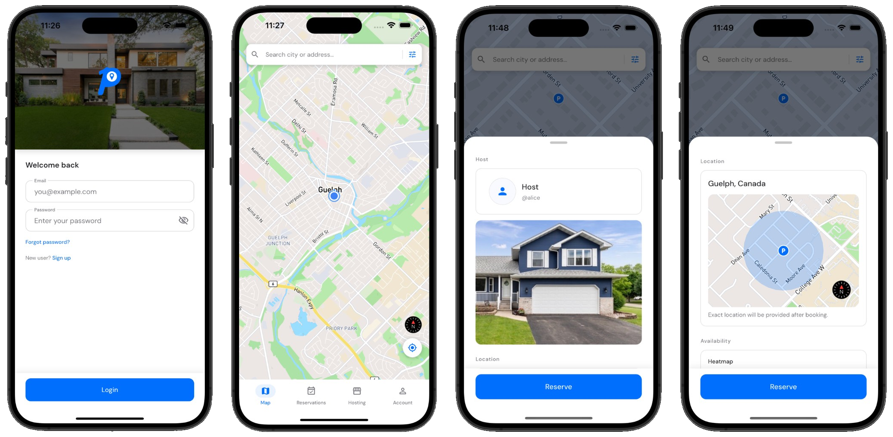
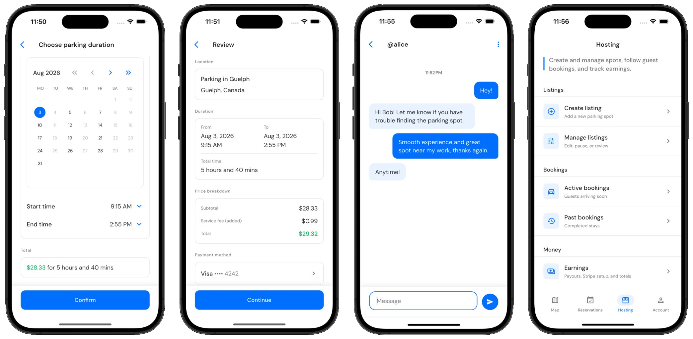
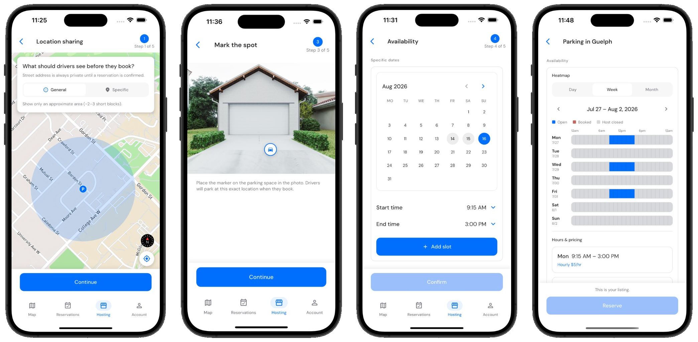

<p align="center">
  
</p>

<p align="center">
  <strong>Space to spare. Parking to share.</strong><br>
  A parking marketplace built with Flutter
</p>

<p align="center">
  
  
  
  
</p>

<p align="center">
  <a href="https://flutter.dev/"></a>
  <a href="https://dart.dev/"></a>
  <a href="https://riverpod.dev/"></a>
  <a href="https://supabase.com/"></a>
  <a href="https://www.postgresql.org/"></a>
  <a href="https://stripe.com/"></a>
  <a href="https://www.mapbox.com/"></a>
</p>

<p align="center">
  
</p>

## Overview

Parkd is a parking marketplace where drivers can find and reserve nearby
parking while hosts can list and manage unused spaces. The application includes
payments, messaging, listing management, availability, notifications, and a
Supabase backend protected by PostgreSQL RLS.

## Features

- Search parking spots and view approximate locations on Mapbox.
- Reserve available parking and complete Stripe checkout (test mode for local).
- Manage active and past reservations with participant messaging.
- Create listings, upload photos, configure availability, and review earnings.
- Manage profiles, payment methods, and notification preferences.

## More Frames

<p align="center">
  
  
</p>

## Quick Start

Install [Flutter 3.41.5](https://docs.flutter.dev/get-started/install), then run:

```bash
cp dart_defines.example.json dart_defines.local.json
flutter pub get
flutter run --dart-define-from-file=dart_defines.local.json
```

Put your Supabase, Mapbox, and Stripe (test) keys in `dart_defines.local.json`.

## Checks

```bash
flutter analyze
flutter build web --release
```

## Project Map

| Path | Purpose |
|---|---|
| `lib/` | Flutter features, providers, repositories, and shared UI |
| `supabase/migrations/` | Database schema |
| `supabase/functions/` | Stripe, geocoding, and related APIs |

## Contributors

Parkd was created by [Paul Mancion](https://github.com/MindMidas),
[Somtochukwu Umeh](https://github.com/Augustine-Umeh),
[Ashmit Mittal](https://github.com/ashmitmittal04), and Ayomide Awofisayo.

## License

Copyright (c) 2026 Parkd contributors. All rights reserved. This source code is
provided for portfolio and review purposes only. See [LICENSE](LICENSE) for
details.
